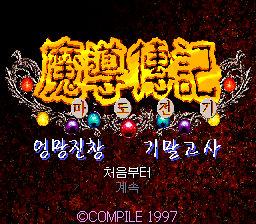

# 마도전기 엉망진창 기말고사 — SFC 포팅

한국판 디스크스테이션 1호의 《마도전기 엉망진창 기말고사》를 슈퍼패미컴(SFC)에서 플레이할 수 있도록 변환하는 웹 패쳐입니다. 한국어 대사와 음성을 포함합니다.

## 지원 원본

한국판 디스크스테이션 1호의 《마도전기 엉망진창 기말고사》 게임 폴더 전체가 필요합니다.

## 적용 방법

웹 패쳐: [hachamecha.retrogame.cloud](https://hachamecha.retrogame.cloud/)

1. 마도전기 엉망진창 기말고사 게임 폴더 전체를 ZIP으로 압축합니다. 이미 ZIP으로 가지고 있다면 그대로 사용해도 됩니다.
2. 웹 패쳐에서 **ZIP 파일 선택**을 눌러 원본 ZIP을 선택합니다.
3. **ROM 만들기**를 누릅니다.
4. 변환이 끝나면 **ROM 다운로드**를 눌러 완성된 ROM을 내려받습니다.

게임 폴더가 ZIP 안에 들어 있어도 됩니다. 원본 파일의 버전은 패쳐가 자동으로 확인합니다.

## 실행 방법

내려받은 ROM을 SFC 에뮬레이터에서 실행합니다.
